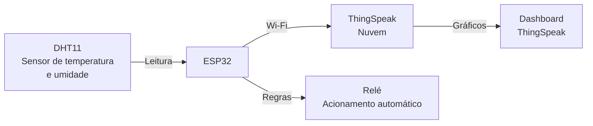

<div align="center">

# 🌡️ ESP32 + DHT11 + Relé + ThingSpeak

### Monitoramento ambiental com acionamento automático em nuvem.

**IoT · Sensores · Automação · Computação em nuvem**

<br>


<br>

**Atividade acadêmica individual • IoT e Computação em Nuvem**

[Visão geral](#-visão-geral) · [Funcionalidades](#-funcionalidades) · [Arquitetura](#️-arquitetura) · [Como executar](#-como-executar) · [Aprendizados](#-aprendizados)

</div>

---

<details>
<summary>📑 Índice</summary>

- [Visão geral](#-visão-geral)
- [Funcionalidades](#-funcionalidades)
- [Visualização em tempo real](#-visualização-em-tempo-real)
- [Arquitetura](#️-arquitetura)
- [Estrutura do projeto](#-estrutura-do-projeto)
- [Como executar](#-como-executar)
- [Regras de acionamento](#-regras-de-acionamento)
- [Validação](#-validação)
- [Aprendizados](#-aprendizados)
- [Sobre o projeto](#-sobre-o-projeto)

</details>

---

## 🧭 Visão geral

Projeto acadêmico individual que integra **Internet das Coisas (IoT)** e **computação em nuvem** utilizando o microcontrolador **ESP32**.

O sistema coleta **temperatura e umidade** através do sensor **DHT11**, envia os dados em tempo real para a plataforma **ThingSpeak** e aciona automaticamente um **relé** com base em regras definidas de temperatura e umidade.

> **A ideia central:** transformar leituras ambientais em decisões automáticas e visibilidade remota, conectando hardware, software e nuvem em um fluxo único.

---

## ✨ Funcionalidades

<table>
  <tr>
    <td width="50%">
      <h3>📡 Coleta de dados</h3>
      Leitura de temperatura e umidade relativa do ar via sensor DHT11.
    </td>
    <td width="50%">
      <h3>☁️ Envio para a nuvem</h3>
      Transmissão dos dados em tempo real para a plataforma ThingSpeak.
    </td>
  </tr>
  <tr>
    <td>
      <h3>🔌 Acionamento automático</h3>
      Controle do relé com base em regras de temperatura e umidade.
    </td>
    <td>
      <h3>📊 Visualização remota</h3>
      Gráficos atualizados em tempo real no canal do ThingSpeak.
    </td>
  </tr>
</table>

---

## 📊 Visualização em tempo real

Os dados enviados pelo ESP32 podem ser acompanhados em tempo real no ThingSpeak:

<div align="center">

### 👉 [Canal ThingSpeak — ESP32 DHT11](https://thingspeak.mathworks.com/channels/3088655)

</div>

---

## 🏗️ Arquitetura



### Stack utilizada

| Componente | Papel no projeto |
|---|---|
| **ESP32** | Microcontrolador principal |
| **DHT11** | Sensor de temperatura e umidade |
| **Módulo relé** | Acionamento automático de cargas |
| **MicroPython** | Linguagem de programação embarcada |
| **Thonny IDE** | Ambiente de desenvolvimento e upload |
| **ThingSpeak** | Plataforma de IoT em nuvem |
| **Wi-Fi** | Conectividade do ESP32 com a internet |

---

## 📂 Estrutura do projeto

```text
esp32-dht11-rele/
├── esp32_dht11_rele.py    # Programa principal
│                          #   → coleta dados do DHT11
│                          #   → envia ao ThingSpeak
│                          #   → controla o relé
└── wifi_lib.py            # Biblioteca auxiliar de conexão Wi-Fi
```

| Arquivo | Descrição |
|---|---|
| `esp32_dht11_rele.py` | Programa principal. Coleta dados, envia ao ThingSpeak e controla o relé. |
| `wifi_lib.py` | Biblioteca auxiliar responsável pela conexão com a rede Wi-Fi. |

---

## 🔌 Regras de acionamento

O relé é acionado automaticamente com base nas leituras do sensor:

| Condição | Estado do relé |
|---|---|
| Temperatura > 31 °C | 🔴 **Ligado** |
| Umidade relativa > 70 % | 🔴 **Ligado** |
| Caso contrário | ⚫ **Desligado** |

> As condições são avaliadas de forma independente. Se **qualquer uma** for atendida, o relé é acionado.

---

## 🚀 Como executar

### Pré-requisitos

- ESP32 com MicroPython instalado
- Sensor DHT11
- Módulo relé
- Thonny IDE instalado no computador
- Conta no [ThingSpeak](https://thingspeak.com)
- Rede Wi-Fi disponível

### Passo a passo

**1. Configure as credenciais de Wi-Fi**

Edite o arquivo `wifi_lib.py` e insira o nome e a senha da sua rede:

```python
SSID = "nome_da_sua_rede"
PASSWORD = "senha_da_sua_rede"
```

**2. Configure a chave do ThingSpeak**

No arquivo `esp32_dht11_rele.py`, substitua a constante `THINGSPEAK_WRITE_API_KEY` pela sua chave de escrita do ThingSpeak:

```python
THINGSPEAK_WRITE_API_KEY = "sua_chave_de_escrita_aqui"
```

> A chave é obtida no painel do canal do ThingSpeak, em **API Keys**.

**3. Carregue o código no ESP32**

Usando o **Thonny IDE**:

1. Conecte o ESP32 ao computador via USB.
2. Selecione a porta correta do dispositivo no Thonny.
3. Faça upload dos arquivos `esp32_dht11_rele.py` e `wifi_lib.py` para o ESP32.
4. Execute o programa.

**4. Acompanhe os dados**

Abra o [canal do ThingSpeak](https://thingspeak.mathworks.com/channels/3088655) no navegador para visualizar os gráficos atualizados em tempo real.

---

## 🧪 Validação

- [ ] Leitura correta de temperatura e umidade pelo DHT11.
- [ ] Conexão bem-sucedida do ESP32 à rede Wi-Fi.
- [ ] Envio consistente de dados ao ThingSpeak.
- [ ] Acionamento do relé com temperatura acima de 31 °C.
- [ ] Acionamento do relé com umidade acima de 70 %.
- [ ] Desligamento do relé quando nenhuma condição é atendida.
- [ ] Atualização correta dos gráficos no dashboard do ThingSpeak.

---

## 📚 Aprendizados

Desenvolver este projeto envolveu mais do que conectar componentes. Os principais aprendizados:

- **Integração entre hardware e software** — leitura de sensores, controle de atuadores e comunicação entre componentes físicos e lógicos.
- **Programação embarcada com MicroPython** — escrita de código para um ambiente com recursos limitados.
- **Comunicação em rede** — conexão do ESP32 à internet via Wi-Fi e envio de dados para uma API em nuvem.
- **Integração com plataforma de IoT** — uso do ThingSpeak para armazenar, processar e visualizar dados de sensores.
- **Automação baseada em regras** — tradução de condições ambientais em ações físicas por meio do relé.
- **Depuração em ambiente embarcado** — investigação de problemas de conexão, leitura e upload de código.

---

## 👨‍💻 Sobre o projeto

Desenvolvido por **Ericsson Alexsander**, estudante de Análise e Desenvolvimento de Sistemas na PUCPR.

Este projeto foi desenvolvido de forma **individual** como atividade acadêmica, com o objetivo de integrar IoT e computação em nuvem em uma solução funcional que conecta sensores, microcontrolador, atuador e plataforma em nuvem.

**Competências demonstradas pelo trabalho:** programação embarcada, integração de sensores, comunicação em rede, automação baseada em regras e uso de plataformas de IoT.

---

<div align="center">

**ESP32 + DHT11 + Relé + ThingSpeak**  
*Do sensor à nuvem — e da nuvem à ação.*

</div>
